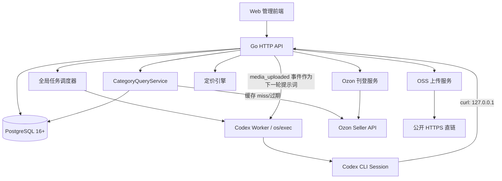
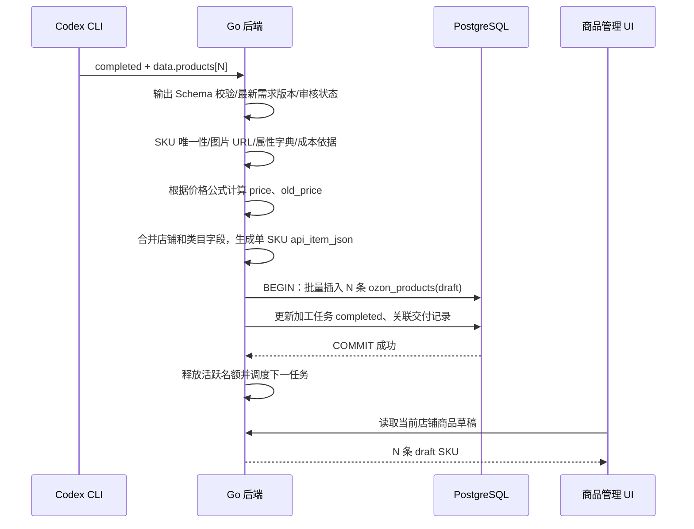
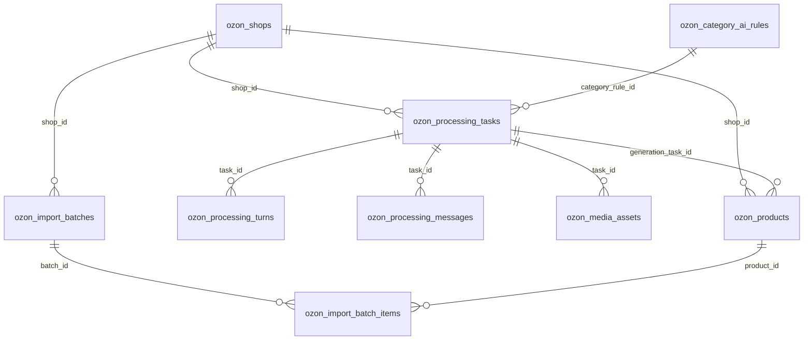

# Ozon 本地 AI 商品加工与自动刊登系统——最终需求规格说明书

> 文档版本：V1.0（整合截至 2026-11-13 的全部确认需求）  
> 适用对象：产品负责人、前后端开发者、Codex / AI 编程助手、测试人员  
> 文档性质：项目实现的**权威需求基线**。其中“已确认”是必须实现的业务规则；“建议实现”是保障正确性所必需的工程细化；“待配置/待验证”不得由 AI 擅自假定固定数值。  
> 技术基线：本地部署；Go 后端；PostgreSQL 16+；Web 管理后台；Codex CLI 非交互执行；Ozon Seller API；可配置 OSS。  
> **重要：本文替代之前讨论中被否定或修订的方案。不得重新引入 MCP、Codex App Server、实时流式会话界面、复杂店铺表、拆分的类目提示词。**

---

## 0. 一页式实施摘要

本项目面向中国跨境卖家，在本地管理一个或多个 Ozon 店铺。操作者在全局选择当前店铺、上传来自 1688 等来源的商品资料、选择 Ozon 官方类目与商品类型、输入主 SKU、可选货源链接并启动 AI 加工任务。系统调用 **Codex CLI**，根据该类目**唯一的一段完整提示词**处理资料，输出商品信息、属性候选、成本以及视觉设计；支持在同一 Codex Session 多轮补充、审核、改稿、生成图片或视频。用户可在 Codex 运行时提交新要求，Go 后端先排队保存，待当前 CLI 轮次结束后自动 `resume`，不打断当前轮。生成的素材由 Go 后端上传到已配置 OSS，获取公开直链后回传给同一会话，Codex 将对应素材映射到 SKU 媒体字段，再交付固定格式 JSON。

后端对 Codex JSON 进行严格校验、绑定原任务店铺和类目、查询/核验 Ozon 属性字典、按公式计算售价与划线价、构建 Ozon 单 SKU API JSON，并在事务内为每个 SKU 创建一条 `ozon_products` 记录，**统一状态 `draft`（草稿）**。加工任务此时才置为 `completed`，释放并行名额。运营人员在商品管理页可按店铺、SKU、状态筛选、编辑、校验以及单选/多选商品调用 `/v3/product/import` 上架；成功提交后还需轮询导入结果、平台审核/可售状态，三个状态不得混为一谈。

系统设有全局最大**活跃加工任务数** `max_active_tasks`（默认建议 3，可配置），名额从任务被调度启动一直占到完成、最终失败或取消；等待补充/审核也占名额。超限的新任务在 PostgreSQL FIFO 队列等待，名额释放后自动启动。Codex 使用提示词中的 `curl` 调用 Go 提供的少量**本地只读 REST 接口**查询属性/字典值；后端先读本地缓存，未命中/不完整时再访问 Ozon，**不使用 MCP**。

### 0.1 已确认原则（不可偏离）

1. **商品粒度**：一个店铺内，一个独立可售 SKU 对应 `ozon_products` 一条记录；同一原始商品可生成多个 SKU。
2. **全局店铺**：店铺切换位于全局导航；新加工任务继承当时 `shop_id` 并冻结，上传原始素材界面不重复选择店铺。
3. **类目选择**：上传素材时选择官方类目与商品类型；系统填写 `description_category_id` 和 `type_id`，Codex 不得自行更改。
4. **一个类目一段提示词**：同一 `(description_category_id,type_id)` 一份完整提示词，统一涵盖俄文文案、属性填写、成本提取、视觉方案和特殊规则；系统通信 Schema 与提示词分离。
5. **成本来源**：`cost` 由 Codex 从商品资料及已补充信息提取，含单件采购价和到国内货代的分摊运费；无法确认时返回 `needs_input`，不得编造。
6. **价格归属**：`price`、`old_price` 由后端定价/划线价公式计算，Codex 不计算最终刊登价；原公式系数尚未约定，须配置。
7. **固定回复**：每轮 Codex 以约定 JSON Schema 返回最终业务消息；Go 后端再次校验，不接受自然语言取代 JSON。
8. **单任务单会话**：一条加工任务对应一个 Codex Session ID；每轮 `codex exec` / `codex exec resume`，无需实时流式展示。
9. **执行中追加要求**：立即入库排队，但不注入正在运行的 `codex exec`；当前轮结束后自动续接。新要求的版本优先于旧轮次成果。
10. **OSS 闭环**：Codex 输出生成文件清单，Go 上传 OSS、检查公开 URL，回传同一 Session；Codex 做字段映射；Go 构建最终 API JSON。
11. **交付即草稿**：Codex 完成且所有预期 SKU 成功保存后，任务标记完成；商品记录统一 `publish_status='draft'`，**绝不自动上架**。
12. **任务并发名额**：全局可配置最大活跃任务数；排队持久化；待审核/待补充阶段同样占名额。
13. **类目懒加载**：类目树可同步/缓存，属性和字典按需查询、缓存 miss 回源；不强制首次同步所有字典。
14. **简化店铺表**：`ozon_shops` 严格 9 字段：`id,name,client_id,api_key,currency_code,vat,enable,created_at,updated_at`；API Key 根据当前本地单用户方案明文存储。

### 0.2 适用范围和非目标

**范围内**：本地单用户/小团队运营、一个或多个 Ozon 店铺、1688 等来源商品资料、一件代发 SKU 级加工、AI 图片/视频生成流程的调度与接入、OSS 媒体托管、商品草稿管理、Ozon 创建/更新商品 API、平台结果跟踪、类目动态属性/字典懒加载、按店铺定价。

**本期不包含**：ERP 采购单/库存/仓储/WMS、实际 1688 自动下单、物流履约/运费实时计费、广告投放、Ozon 订单/售后管理、复杂 RBAC、多租户 SaaS、实时 Codex 事件直播、App Server/MCP、无需人工确认的自动刊登、保证视频必能在 Ozon 被接受、在 Codex 无图像/视频工具时凭空实现模型生成能力。

---

## 1. 用户、系统边界及约束

- 用户：本地运营人员，配置店铺、类目规则、OSS 和价格公式；上传素材；在任务中补充要求与审核；在商品管理审核草稿与主动上架。
- Go 后端：全局店铺上下文校验、任务调度、Codex 子进程管理、会话队列、属性查询缓存、OSS 上传、价格计算、Ozon API、数据库一致性。
- Codex CLI：根据固定系统协议和当前类目提示词加工内容、调用允许的本地 `curl` 查询工具、按配置的图片/视频生成能力生成或管理媒体文件、产出结构化业务 JSON。
- Ozon Seller API：权威类目/属性/字典数据源、商品导入和导入结果、平台商品状态。接口与限制按官方当前版本核验。
- OSS：根据系统配置存储完成的图片/视频并提供可长期直接读取的 HTTPS URL。
- PostgreSQL：业务状态、任务队列、会话记录、类目缓存和商品主表的唯一权威存储。

**本地运行 ≠ 完全离线**：Codex 模型推理、Ozon API、OSS 都要求网络可用。若网络/授权不可用，应记录失败或待处理，不声称已完成。

---

## 2. 技术架构



### 2.1 技术选型

| 层 | 决策 | 说明 |
|---|---|---|
| UI | 浏览器 Web 管理台，TypeScript 优先 | 具体框架 React/Vue 尚未指定，选择一个即可，禁止 AI 为追求复杂度引入多个框架 |
| HTTP 服务 | Go | REST API，必要时前端定时轮询；无需 SSE/WebSocket 推送 Codex 实时事件 |
| 数据库 | PostgreSQL 16+ | JSONB 动态属性和 API JSON、事务调度、唯一约束 |
| Codex | `codex exec` + `codex exec resume` | Go `os/exec`，每轮完整执行并读取最终文件，记录 Session ID |
| 输出 | `--output-schema` + `-o` + 可选 `--json` | 每轮传入同一业务 JSON Schema；`--json` 用于提取 `thread.started.thread_id`，不展示中间事件 |
| Codex 查询接口 | 通过 `curl` 访问本地只读 REST | **不使用 MCP**；Go 查询 PostgreSQL，必要时回源 Ozon |
| 媒体 | 可配置 OSS（S3 兼容 / 阿里云等以实际实现为准） | 文件上传由 Go 负责，Codex 不接触 OSS 凭证 |
| 批量刊登 | `/v3/product/import` | 同店铺最多 100 个商品/请求，超出拆分；实际平台配额按官方查询 |

### 2.2 核心 Go 模块（建议的代码组织）

```text
internal/
  shop/               # 全局店铺及 9 字段 CRUD
  category/           # 类目树、属性/字典缓存、Ozon 回源
  prompt/             # 单类目单提示词、版本和快照
  processing/         # 任务、轮次、消息、审核、状态机
  scheduler/          # 最大任务名额、FIFO 调度、启动恢复
  codexcli/           # exec / resume / output-schema / 进程控制
  media/              # 媒体记录、OSS 上传、URL 验证
  pricing/            # 单件成本、汇率、售价/划线价计算
  product/            # SKU 草稿、编辑、API JSON 构造/校验
  publishing/         # Ozon 批量提交/查询状态/重试
  system/             # 最大活跃任务数及 OSS 配置
```

**实现顺序**：先定义 Repository/Service 接口和事务边界，再实现页面，不以页面直接操作数据库或 Codex 子进程。

### 2.3 Codex CLI 生命周期

1. 调度器分配活跃名额，创建独立任务工作目录（如 `work/tasks/<taskId>`），存放上传素材、生成文件、每轮提示词、结果 JSON。
2. 首轮由 Go 启动 `codex exec`，传入 `--output-schema`、`-o`、工作目录，记录进程与轮次；通过机器可读 JSONL `thread.started.thread_id` 获取 Session ID。
3. 后续由 Go 调用 `codex exec resume <SESSION_ID>`，同样传入本轮 Schema 和输出文件；**不用 `--last`，必须指定任务对应 Session**。
4. 每轮完成：退出码成功 → 读取最终回复文件 → JSON 解析 → Schema 检验 → 业务状态检查 → 检查待追加要求 → 处理状态与副作用。
5. CLI 异常/取消/重启：保留 Turn 状态和文件；不确定是否执行过的轮次进入 `uncertain` 人工/系统恢复流程，禁止无条件再次执行相同副作用。
6. 每个任务同一时刻只允许一个 CLI 子进程；多个任务可通过并发名额同时运行。
7. 工作目录受限、允许写入生成文件的 sandbox、允许访问指定本地 REST；Codex 不可读取 Ozon API Key/OSS 凭证或无关业务目录。

> CLI 恢复时使用 `--output-schema` 的能力需在本机已安装版本上以 `codex exec resume --help` 验证。若不支持，优先升级 CLI；不得悄悄改成无约束自然语言解析。网络与本机 `127.0.0.1` 访问必须在实际 Windows/WSL 环境实测。

---

## 3. 业务全链路

### 3.1 全局店铺和配置

1. 首次使用先在“店铺管理”添加 `name`、`client_id`、`api_key`；币种默认 `CNY`、VAT 默认 `0.1`、`enable=true`。
2. 顶部全局店铺选择器决定**新的**商品加工与商品管理当前店铺上下文；未选择或已停用店铺时，禁止创建新加工/刊登任务，并显示原因。
3. 新加工任务创建时**冻结 `shop_id`**；之后切换全局店铺不改变已有任务、历史商品的归属，也不影响正在查询属性的身份凭证。
4. 各店铺商品管理、刊登列表必须按固定 `shop_id` 后端授权/过滤；不能只依赖前端传参。
5. 默认 `CNY`/`0.1` 为用户要求的**本地默认配置**，不是 Ozon 对全部店铺的普适要求；发起商品导入前后端应按真实账户配置和当前 API 约束核验。

### 3.2 类目规则配置

- 左侧展示 Ozon 官方**完整类目树**（支持展开、搜索中文/俄文名、类目 ID/类型 ID、同步/刷新）；不只显示已配置的类目。
- 选择可售类目和类型后，右侧展示**全部属性**（属性 ID、名称、类型、是否必填、字典说明、复杂属性、限制、查询/刷新字典）。
- 每个 `(description_category_id,type_id)` **只允许一个启用的完整提示词** `prompt`；内容自由编写，包括内容提取、成本、俄文标题、属性填充和视觉方案。支持保存、复制其他类目规则、测试。
- 每次修改提示词递增 `version`，在加工任务创建时保存 `category_rule_id`、`version`、`prompt_snapshot`；修改配置不追溯改变已启动任务。
- 如果类目没有专属提示词，使用系统级通用提示词或阻止启动，**选择哪种由系统配置**；本版建议有通用提示词可降级、且在任务详情明确提示。
- **系统固定协议高于类目提示词**：类目提示词可以控制业务生成策略，不能更改 JSON 回复 Schema、禁止捏造价格/ID、审核机制。

### 3.3 上传原始素材与创建加工任务

- 输入：全局 `shop_id`；上传商品主 SKU `base_sku`；Ozon 类目与 `type_id`；图片、截图、描述、视频等原始素材；可选 `origin_link`（例如 1688 链接）；任务级“文案自动审核”“视觉方案自动审核”“视觉成品自动审核”开关。
- 上传界面**不再出现店铺选择框**，店铺显示为顶部全局上下文。上传素材界面必须保留选择 Ozon 类目/类型。
- 原始文件写入任务目录并记录元数据；不要仅传原始 URL 让模型猜测不可访问内容。
- 创建任务固定 `shop_id`、类目、主 SKU、规则快照、素材清单，状态 `queued`；若有名额由调度器自动启动，否则保持排队。

### 3.4 Codex 加工和人工交互

1. Codex 分析素材；如果关键采购成本、国内段运费、规格、属性缺失，返回 `needs_input`（问题数组），系统进入 `waiting_input`。
2. 生成文案、属性候选以及视觉方案时返回 `pending_review`（带 `review.kind` 和具体数据）；系统根据任务级自动审核开关或人工操作记录审批，不由 Codex 自称通过。
3. 审核可“通过/退回/追加要求”，每条回复写入 `ozon_processing_messages` 并携带需求版本，进入同一 Session 的下一轮。
4. 视觉方案审批后按选定生成工具制作主图、副图、颜色图和可选视频；视觉成品需要审核或任务级自动通过。
5. Codex 最终返回 `media_ready`，列出**真实存在**的相对文件路径、`asset_id`、`sku_ref`、用途和 MIME；系统才允许启动 OSS 上传。
6. 任务进行中随时可以追加要求；新消息只入队，不打断执行。每轮完成先检查排队消息；若有消息，**先续接改稿，旧 `pending_review/media_ready/completed` 不触发自动下一阶段**。
7. OSS 成功上传并验 URL 后，Go 在原会话发送 `media_uploaded` 系统事件（作为下一轮文本/JSON 输入），Codex 输出更新后的结构化商品字段，尤其 SKU 对应主图、副图、颜色图与视频属性映射。
8. Codex 返回 `completed` 时表示**AI 已交付结构化数据**，并非加工任务已完成；后端必须进一步完成校验、定价、入库，成功后才将任务设为 `completed`。

### 3.5 交付至商品管理（**必须严格遵循**）



**事务/幂等边界**：同一个加工任务同一个稳定 `sku_ref` 只允许生成一条目标商品。正式插入使用 `(shop_id,offer_id)` 唯一约束，建议额外建立交付关联唯一约束 `(generation_task_id,sku_ref)`（若 `sku_ref` 不在主表，则放交付映射表）。重复回调/异常重试不得插入重复草稿，也不得覆盖其他任务已存在 SKU。所有预期 SKU 插入/校验成功、任务终态提交后才释放并发名额。非阻断性属性缺失可以保存 `draft + validation_status=invalid`；阻断性的 SKU 冲突、无归属、结构损坏应阻止原子交付并进入修正/失败处理。

**交付后**：`ozon_processing_tasks.status='completed'`；每条 `ozon_products.publish_status='draft'`；商品默认没有提交过 Ozon、没有 Ozon `task_id`，不能显示“已上架”。商品从加工记录只读查看原始来源；后续改价/改图只更新商品主表及版本，不回写 Codex 历史。

### 3.6 商品管理与 Ozon 上架

- 列表**一条记录就是一个可独立售卖 SKU**；可按 `offer_id`、`base_sku`、内部刊登状态、审核/校验状态、类目、当前店铺筛选。
- 支持按 SKU 修改俄文标题、成本、价格（如允许人工覆盖需明确记录）及划线价、主图/副图/颜色图、包装、属性、`api_item_json`；改动影响 API 时，后端重新构建 JSON 并递增 `api_json_revision`，重新校验。
- `api_item_json` 是由**后端**构造的单商品对象；不包含外层 `{"items":[]}`。展示为可审阅 JSON；如果允许直接编辑 JSON，必须再解析映射回结构化字段，并校验两者一致，不能静默产生双份权威数据。
- 运营主动单选或多选 SKU 刊登；只允许同店铺商品混合提交，超过单次限额时拆批；从各商品的 JSON 快照构造 `{ "items": [ ... ] }`。
- 提交前做后端预检：所需字段、类目与字典、图片 URL、币种/VAT、价格、审核和当前修订版校验。校验不通过不可提交。
- 通过 Ozon `/v3/product/import` 提交后记录 Ozon `task_id` 并更新内部 `submitting/processing`，**不立即标记 `imported`**；随后调用 `/v1/product/import/info` 查询逐 SKU 结果，只有成功项才标记导入成功，失败项记录错误可单独重试。
- 平台审核 `ozon_moderation_status` 和平台可售 `ozon_sale_status` 分别回读，与内部 `publish_status` 相互独立。
- 修改已导入商品：提交当前完整商品数据，保存每次请求快照 `submitted_revision`；以 Ozon 确认成功的版本回填 `last_imported_revision`。如果 `api_json_revision != last_imported_revision`，提示“有未同步修改”。

---

## 4. 任务并发、队列和追加要求

### 4.1 全局任务限额

- 配置项：`ozon_system_settings.max_active_tasks`，默认建议 **3**，允许管理员在系统设置中修改，必须是正整数。
- 占用名额的状态：`dispatching`, `running`, `waiting_input`, `waiting_review`, `uploading_media`, `finalizing`。
- 不占名额：`queued`, `completed`, `failed`, `cancelled`。
- 任务一经获得名额，直到终态都持有同一个名额；**等待补充/审核时不释放**。这严格遵循用户定义的“有加工任务结束才启动队列新任务”。
- 新任务 FIFO（`created_at,id`），系统重启不会丢队列；释放名额、创建任务、增大上限、进程启动和巡检均触发补位。
- 修改上限从高到低时不强杀在跑任务，只阻止新任务获得名额，直到活跃数低于新上限。
- 事务中锁定唯一系统设置行、计算活跃数并领取 queued 记录；提交事务后才启动 CLI。进程崩溃后需恢复 `dispatching` 等中间状态。

### 4.2 任务状态（由后端权威维护）

| `status` | 含义 | 占名额 | 进入/退出条件 |
|---|---|---|---|
| `queued` | 等待名额 | 否 | 新建/重试时入队 |
| `dispatching` | 已领取名额，尚未确认启动 CLI | 是 | 调度事务成功 |
| `running` | 正在执行 Codex Turn | 是 | 进程已启动 |
| `waiting_input` | 等待用户补充关键资料 | 是 | Codex `needs_input` 且无排队新要求 |
| `waiting_review` | 等待人工审核 | 是 | Codex `pending_review` 且未自动审批 |
| `uploading_media` | OSS 上传/核验 | 是 | 有效、已批准的 `media_ready` |
| `finalizing` | 标准化、定价、商品入库 | 是 | 有效、通过全部审批的 `completed` |
| `completed` | 全部 SKU 已入商品草稿 | 否 | 交付事务提交成功 |
| `failed` | 任务失败终止 | 否 | 超过安全重试/不可恢复错误 |
| `cancelled` | 已确认取消并停止副作用 | 否 | CLI/OSS 操作已停止且资源核对完成 |

操作员可以在任何 `running` 任务的页面追加要求；系统应展示“已排队（将在本轮结束后发送）”，不可谎称“Codex 已收到”。

### 4.3 消息与需求版本规则

- 入队追加要求时，对该任务加行锁；更新 `requirement_revision += 1`；插入消息 `delivery_status='pending'`，按消息 ID 排序。
- 每次启动 Turn 记录本次已包含的最大需求版本 `input_max_requirement_revision`；按序发送所有当前 pending 的用户/系统消息。
- Turn 完成后，在同一锁定边界检查是否出现比本次版本更新的待发送消息；有则将旧回复保存在历史但不自动进入审核/上传/最终入库，先自动 resume。
- 新要求提交恰逢 OSS 上传或 finalizing 时，也必须再次比较版本；过时成果不能入库。已在 OSS 上传但被新需求替换的文件保留记录并标记为旧版，不作为最终图片。
- 消息状态 `pending → sent → accepted`，当进程/网络故障无法确认是否应用时标记 `uncertain`。`accepted` 表示已纳入成功完成的会话轮次，不代表模型完全满足业务要求，需校验最终结果。
- 同一个 Session 同一时刻只运行一个 Turn。用户点击取消时设置 `cancel_requested`，确认子进程和外部动作停止后转 `cancelled` 并释放名额。
- 轮次处理优先级：**进程/Schema 错误 → 待发送新要求 → needs_input → pending_review → media_ready → completed → failed**。`failed` 是模型报告业务失败；CLI/后端基础设施失败另行记录，不能无条件转成模型完成。

### 4.4 恢复与重试

- Go 重启时扫描 `dispatching/running/uploading_media/finalizing`，根据子进程、文件、外部响应和数据库记录判断恢复方式；不可盲目启动同 Session 的第二个 Turn。
- CLI 异常退出、输出 JSON 破损：允许在同一 Session 发起有限次数纠正重试；超过次数保留错误，等待人工重试。非确定性执行结果标记 `uncertain`。
- OSS 上传采用 `task_id/sku_ref/asset_id` 稳定对象键，并持久化 `object_key`/`public_url`，相同素材重试应幂等。
- 任务在 `failed/cancelled` 后若要求重试，重新进入 `queued` 争取名额；不能绕过并发限制。
- 当三条活跃任务都在 `waiting_review` 时，第四条必须继续排队（有意设计的限制）。

---

## 5. Codex 标准 JSON 通信协议

### 5.1 区分两层协议

1. **Codex CLI 运行接口**：进程退出、输出文件、JSONL `thread_id`/Turn 事件，仅供后端内部使用。
2. **应用业务回复**：完整 JSON Schema 固定结构，供状态机和前端展示。所有轮次 `--output-schema` 使用 `02_codex_reply_v1_2.schema.json`；服务端再次校验。

统一响应信封（省略 `data` 内细节）：

```json
{
  "schema_version": "1.2",
  "status": "needs_input",
  "stage": "extract",
  "message": "请补充每件商品发往国内货代的运费。",
  "questions": [],
  "review": null,
  "data": {
    "products": [],
    "visual_plan": [],
    "media": [],
    "warnings": []
  },
  "error": null
}
```

`message` 永远是面向用户的字符串，不能塞入 JSON 字符串充当商品对象。**最终 SKU 数据只在 `data.products`**。

### 5.2 Codex 业务状态

| `status` | 何时返回 | 后端行为与约束 |
|---|---|---|
| `needs_input` | 缺成本/运费/关键属性等不可猜测信息 | `questions` 非空；任务 `waiting_input`，展示问题 |
| `pending_review` | 文案、视觉方案或视觉成品待审核 | `review.kind` 通常为 `copy/visual_plan/visual_result`（Schema 兼容保留 `final`，若返回则按人工最终审核处理）；展示审核，自动审核由任务开关控制 |
| `media_ready` | 已通过适用的视觉审批，图片/视频真实文件已生成 | `data.media` 非空；验证文件、上传 OSS、回传 URL |
| `completed` | 交付结构化 SKU 列表 | `data.products` 非空；后端校验、定价、创草稿，任务方可完成 |
| `failed` | AI 业务无法继续 | `error.code/message` 明确；记录失败并提供恢复方式 |

`stage` 使用 `extract/copy/visual/delivery`，用于界面定位；`in_progress` 不属于模型回复，运行态由进程/后端维护。

### 5.3 最终产品数据契约（每个 `data.products[]`）

| 字段 | 含义与限制 |
|---|---|
| `sku_ref` | 当前任务中稳定的 SKU 关联标识，与媒体 `sku_ref` 相匹配 |
| `offer_id_suggestion` | Codex 根据 `base_sku` 建议的卖家 SKU；后端确认唯一性 |
| `variant_label` | 颜色/尺码等可读规格 |
| `name` | 俄文标题 |
| `cost` | 对象：`purchase_price`, `domestic_shipping`, `total`, `currency='CNY'`, `evidence`；未知写 `null`，不得猜测 |
| `primary_image` | OSS 上传后返回并确认的主图直链 |
| `images` | OSS 副图公开直链数组，有序 |
| `color_image` | 颜色图公开直链，可空 |
| `dimensions` | `depth`, `width`, `height`, `dimension_unit='mm'`, `weight`, `weight_unit='g'` |
| `attributes` | `id`, `complex_id`, `value_text`, `dictionary_value_id`, `evidence` 组成的属性候选数据 |
| `complex_attributes` | 复杂属性/视频映射，具体必须符合当前官方结构 |

**不得由 Codex 决定/覆盖**：`shop_id`、最终类目 ID、系统 VAT、刊登币种、最终 `price`/`old_price`、Ozon `product_id/sku`、平台审核结果。

**视频特别规则**：OSS 可以存储 MP4 及其他媒体，但 Ozon 并非接受任意视频 URL 作为顶层商品字段。Codex 可以建议 `complex_attributes` 映射；后端必须按当前类目支持的属性结构及 Ozon 支持的视频链接类型校验。不合法视频不能导致虚假的“上架成功”，可作为内部素材保留并报阻断/警告。

### 5.4 系统发给 Codex 的事件

用户补充、审核结论及 OSS 上传结果由后端发送到**同一个 Session** 的下一轮。推荐事件格式（这不是 Codex 的回复 Schema）：

```json
{
  "event": "media_uploaded",
  "task_id": 1001,
  "media": [
    {
      "asset_id": "a-main-001",
      "sku_ref": "CAR001-GY",
      "role": "primary",
      "url": "https://cdn.example.com/tasks/1001/main.png"
    }
  ]
}
```

Codex 按 `sku_ref + asset_id + role` 把 URL 填入对应 SKU。后端只接受与 `ozon_media_assets` 中已确认上传成功的素材匹配的 URL。

### 5.5 JSON Schema 约束与业务验证

- 限制 `schema_version`、枚举、类型、必填字段、数组项结构，并对对象使用 `additionalProperties:false`（按 schema 实际内容）。
- 结构化约束**不能保证业务真实**；必须检查 `completed` 商品数量、成本证据、SKU 冲突、类目属性合法性、审核通过、媒体 URL、需求版本。
- 每轮若模型拒绝、无最终输出、文件为空、断电或 schema 不匹配，后端返回自身稳定的错误结构，不把未知内容当作成功业务回复。

---

## 6. 类目属性与字典值懒加载设计

### 6.1 UI 需求

- 左侧完整 Ozon 类目树，包含搜索框，按类目/类型组合选中。
- 右侧完整属性列表可搜索、按必填/字典/复杂属性筛选，能查询字典候选值。
- 显示同步来源与时间、缓存完整性；支持手动刷新当前类目/属性/字典。
- 不要求在部署时全量下载所有字典值；仅用户或 Codex 查询时加载。

### 6.2 REST 接口（供 Web 与 Codex curl 共用）

```http
GET /api/categories/{category_id}/types/{type_id}/attributes
GET /api/categories/{category_id}/types/{type_id}/attributes/{attribute_id}/values?keyword=серый
GET /api/categories/{category_id}/types/{type_id}/attributes/{attribute_id}/values?page=1&page_size=100
```

- 第一接口：本地查询 `(shop_id,category_id,type_id,language)` 属性缓存，未命中或过期时调用 `POST /v1/description-category/attribute`，持久化后返回全部属性。
- 第二接口：本地按文本/ID 查询字典，缓存不完整或查询未命中时调用 `POST /v1/description-category/attribute/values/search`；缓存成功结果并返回。
- 第三接口：按本地 `last_value_id` 对接 `POST /v1/description-category/attribute/values` 分页，维护 `partial/complete`；首次分页或缓存不足时可回源。
- 查询参数、返回结构由 Go 统一封装；Ozon 授权头只能由 Go 使用当前**任务冻结的 shop_id** 读取，Codex 永远不接触 API Key。
- 同 Key 并发请求做 singleflight/短锁去重；失败返回明确代码（如 `OZON_UPSTREAM_UNAVAILABLE`），不可伪装为无属性/无字典。
- `partial` 缓存的本地搜索未命中不代表 Ozon 无该值；`complete` 也受时效约束，可按 TTL 失效。
- 字典缓存主键至少包含：`shop_id + description_category_id + type_id + attribute_id + language + value_id`。

### 6.3 Codex 通过 curl 查询

- 通过系统公共提示词传入本地只读 API 的完整调用方法，**不使用 MCP**。
- Windows 原生 PowerShell 环境优先使用 `curl.exe -sS`（避免别名冲突）；需要 URI 编码关键词，实际示例：`curl.exe -sS "http://127.0.0.1:8080/api/categories/17028922/types/91565/attributes"`。
- 在 CLI sandbox 中应显式允许访问受控的本地 REST API，不使用全权限模式代替正常配置；支持 localhost 失败的诊断。
- 推荐 API 使用仅对当前任务有效的只读 Token 或以本地进程边界保护；只能查类目与字典，不应暴露写商品、店铺密钥或 OSS 配置接口。
- 类目提示词可要求 Codex先查询属性/候选字典；无论是否真的调用工具，**后端在正式生成 API JSON 时必须再次校验**。

---

## 7. OSS 媒体生产与回填

### 7.1 阶段

1. Codex 生成视觉方案，返回 `pending_review`。
2. 方案审批后生成媒体；视觉成品审核通过后返回 `media_ready` 并列出每个本地文件。
3. Go 对 `file_path` 进行规范化与安全校验，必须落在当前任务工作目录，不允许 `../` 越界或访问系统其它文件。
4. 校验文件存在、格式、大小、图片分辨率、视频 MIME、SKU 关联；未通过时报错/待修复。
5. Go 将素材上传 OSS，保存 object key、稳定公开 URL、上传时间与状态；失败重试不重复生成对象。
6. Go 验证 URL 可通过 HTTPS 公网直接读取，并符合 Ozon 对图片格式/尺寸/可访问性的要求；短期签名 URL 不得用于永久商品图片。
7. Go 将 `media_uploaded` 事件发给同一 Codex Session，Codex 返回最终结构化商品数据，完成媒体字段填充。
8. Go 再次校验 URL 是否与已上传素材一致，禁止 Codex 自行编造 OSS URL。

### 7.2 OSS 设置（全局）

应提供 OSS Provider、Endpoint、Bucket、Access Key、Secret Key、Public Base URL 等系统级配置（不写入 9 字段店铺主表）。存储方式可为本机应用配置或受保护的系统设置；凭证不得传给 Codex、前端或打印到日志。**OSS 支持类型和域名规则必须实际配置后才能启用上传。**

### 7.3 媒体与商品字段

- `role=primary` → `primary_image`
- `role=detail/lifestyle/selling_point` → `images[]`（按展示顺序）
- `role=color` → `color_image`
- `role=video` → 按当前 Ozon 类目 `complex_attributes` 及平台支持的视频类型映射；不应凭空创建 `video` 顶层字段。

---

## 8. 定价与成本计算

- Codex 提取单 SKU：采购单价 `purchase_price`、到货代单件分摊运费 `domestic_shipping`，给出可追溯证据，`cost=purchase_price+domestic_shipping`，成本币种默认 `CNY`。
- 采购页面未提供单件分摊运费时，Codex 必须返回 `needs_input`；不允许将未知值视为 0。
- 后端价格引擎根据 `cost`、汇率、佣金、国际物流、风险缓冲、预期利润、四舍五入规则等**配置参数**计算 `price`，再使用单独的划线价规则计算 `old_price`。
- 这些参数与具体公式**用户尚未定稿**；应设计可配置定价规则而非写死 `×2` 等未经确认的公式。支持保存 `pricing_rule_id` 和 `pricing_snapshot`，确保可追溯。
- 店铺 `currency_code` 默认 CNY；实际创建商品前需核对 Ozon 账户的价格币种配置，保持币种一致。
- 店铺 VAT `0.1` 是用户指定的本地默认，正式商品请求需要按相应店铺/当前 API 规则转换和校验。
- 商品人工修改成本或者切换定价规则时应重新计算、增加 JSON 版本、撤销旧校验结果；批量重新定价必须由用户主动触发，不因公式调整静默改价。

---

## 9. 数据库设计（PostgreSQL 16+）

### 9.1 关系总览



详细 DDL 见 `03_数据库参考DDL.sql`。该 SQL 是**全新库的参考初始化设计**，并非旧数据库的原位升级脚本。若已存在前期版本，单独编写迁移并测试。

### 9.2 `ozon_shops`（**严格 9 字段**）

| 字段 | 类型 | 规则 |
|---|---|---|
| `id` | BIGINT PK | 自增 |
| `name` | VARCHAR(128) | 店铺展示名称，必填 |
| `client_id` | VARCHAR(64) | Ozon Client-Id，唯一，必填 |
| `api_key` | TEXT | Ozon Api-Key，按已确认本地方案**明文**保存，必填 |
| `currency_code` | VARCHAR(3) | 默认 `CNY` |
| `vat` | NUMERIC(5,3) | 默认 `0.1` |
| `enable` | BOOLEAN | 默认 `true` |
| `created_at` | TIMESTAMPTZ | 创建时间 |
| `updated_at` | TIMESTAMPTZ | 更新时间 |

不要把加密状态、API 验证状态、默认定价规则、卖家国家、审核开关等再加入 `ozon_shops`。本地明文密钥仍须保护数据库备份和日志。

### 9.3 `ozon_products`（SKU 主表，沿用 V2.0 54 字段）

| 分组 | 字段（完整列表） | 含义 |
|---|---|---|
| 标识与货源（7） | `id, shop_id, generation_task_id, base_sku, offer_id, variant_label, origin_link` | 一店一 SKU；任务关联；可选 1688 链接 |
| 类目与基础（5） | `description_category_id, type_id, new_description_category_id, name, barcode` | 类目/类型由系统冻结；条码初始可空 |
| 成本与定价（9） | `cost, cost_currency_code, cost_source_json, price, old_price, currency_code, vat, pricing_rule_id, pricing_snapshot` | AI 成本、系统定价、计算快照 |
| 媒体与属性（14） | `primary_image, images, color_image, pdf_list, depth, height, width, dimension_unit, weight, weight_unit, promotions, attributes, complex_attributes, ai_structured_json` | OSS URL、包装尺寸、动态属性、原始 AI 数据 |
| API 与校验（5） | `api_item_json, api_json_revision, last_imported_revision, validation_status, validation_errors` | 单条可刊登 JSON、版本/校验 |
| 审核与平台（12） | `text_review_status, image_review_status, publish_status, ozon_moderation_status, ozon_sale_status, ozon_product_id, ozon_sku, ozon_status_raw, last_error_json, last_submitted_at, last_imported_at, last_platform_synced_at` | 内审、导入状态与平台实际状态分离 |
| 时间（2） | `created_at, updated_at` | 时间戳 |

主键 `id`；唯一 `(shop_id,offer_id)`（非空时），不同店铺可用相同 SKU；`base_sku` 用于变体归组。`cost_source_json` 保存成本证据；`ai_structured_json` 保存该 SKU Codex 原始交付；`api_item_json` 由后端从各业务字段生成。数据库中允许保留不能上架的 `draft` 草稿；`ready` 需满足全部刊登前置校验。

默认：`dimension_unit='mm'`、`weight_unit='g'`、`pdf_list=[]`、`promotions=[]`、`attributes=[]`、`complex_attributes=[]`、`publish_status='draft'`、`validation_status='unchecked'`；`new_description_category_id=NULL`，而非默认 0。`barcode` 可空，首次导入后根据 Ozon 支持的条码机制更新。

### 9.4 `ozon_system_settings`

| 字段 | 类型 | 说明 |
|---|---|---|
| `id` | SMALLINT PK | 固定 1，全局唯一 |
| `max_active_tasks` | INTEGER | 默认 3，>0 |
| `updated_at` | TIMESTAMPTZ | 配置更新时间 |

### 9.5 类目与提示词

| 表 | 关键字段与约束 | 职责 |
|---|---|---|
| `ozon_category_tree_cache` | `language, tree_json, synced_at` | 完整 Ozon 官方类目树缓存；不同语言可有不同快照 |
| `ozon_category_ai_rules` | `id,description_category_id,type_id,prompt,enabled,version,created_at,updated_at`，类目+类型唯一 | **一类目类型一段完整提示词** |
| `ozon_category_attribute_cache` | `shop_id,description_category_id,type_id,language,attributes_json,fetched_at,expires_at` | 按需缓存全部属性定义 |
| `ozon_attribute_dictionary_values` | `shop_id,description_category_id,type_id,attribute_id,language,value_id,value_text,info,picture,source,fetched_at` | 按需字典值/搜索结果 |
| `ozon_attribute_dictionary_sync` | `shop_id,description_category_id,type_id,attribute_id,language,list_status,last_value_id,synced_at,expires_at` | 分页进度与 partial/complete |

### 9.6 商品加工与会话

| 表 | 核心字段 | 职责 |
|---|---|---|
| `ozon_processing_tasks` | `id,shop_id,description_category_id,type_id,base_sku,origin_link,category_rule_id,category_rule_version,prompt_snapshot,codex_session_id,status,stage,requirement_revision,applied_requirement_revision,copy_auto_approve,visual_plan_auto_approve,visual_result_auto_approve,copy_approved,visual_plan_approved,visual_result_approved,last_reply_json,last_error,admitted_at,finished_at,cancel_requested,created_at,updated_at` | 单任务冻结上下文、审核配置、名额与终态 |
| `ozon_processing_turns` | `id,task_id,seq,run_status,input_max_requirement_revision,output_file,exit_code,reply_json,error_message,started_at,finished_at` | 每次 exec/resume、输出、异常 |
| `ozon_processing_messages` | `id,task_id,turn_id,role,kind,content,payload,requirement_revision,delivery_status,created_at,processed_at` | 全部用户/系统输入与 Codex 最终回复；消息排队 |
| `ozon_media_assets` | `id,task_id,asset_id,sku_ref,role,local_path,object_key,public_url,mime_type,upload_status,error_message,created_at,updated_at` | 生成素材的本地文件、OSS 对象、上传状态 |

**注意**：`origin_link` 及三个自动审批开关必须保存在**任务创建时**，否则会造成上下文丢失；这属于为已确认功能补充的必需字段。消息表完整保存**业务层每轮输入/回复**，非要求录制模型内部推理或所有实时工具事件。

### 9.7 刊登批次与逐 SKU 结果

| 表 | 核心字段 | 职责 |
|---|---|---|
| `ozon_import_batches` | `id,shop_id,ozon_task_id,status,request_json,response_json,last_error,created_at,submitted_at,finished_at` | 同店铺最多 100 商品的一次 Ozon API 批次 |
| `ozon_import_batch_items` | `id,batch_id,product_id,offer_id,submitted_revision,request_item_json,status,ozon_product_id,error_json,created_at,updated_at` | 本次提交商品及快照、独立成功失败 |

商品主表不保存 Ozon 导入 `task_id` 作为唯一历史；平台批次任务 ID 放在刊登批次表。单个 SKU 可属于多次刊登批次，保留历史以便排错与重试。

### 9.8 定价配置

- `ozon_products.pricing_rule_id` 已预留。建议提供独立 `ozon_pricing_rules`：`id,name,enabled,parameters_json,created_at,updated_at`，后端解析**白名单结构化参数**，不要执行任意用户字符串代码。
- 当前**尚未确定真实公式**；数据库仅提供可配置入口，不将未经确认的倍数或汇率写为强制业务规则。
- 因用户明确限定 `ozon_shops` 9 字段，**不得在 shop 表新增 `default_pricing_rule_id`**。可在系统定价设置中配置全局默认规则，后续如需店铺差异用独立关联表实现。

---

## 10. 前端页面与交互设计

### 10.1 全局布局

- 顶部：系统名称、全局店铺切换器（仅启用店铺可新建任务；允许查看停用店铺历史）、系统设置入口。
- 侧边栏：概览/商品加工/商品管理/类目与提示词/刊登记录/店铺管理/系统设置。
- 全页面统一显示加载、空状态、错误、最后更新时间；列表分页及筛选状态可保留。
- **无需实时流式展示 Codex 内部事件**；任务详情仅在 CLI 轮次结束后增量显示该轮结构化回复与执行记录。运行中可显示简单 spinner、当前阶段和可用的“追加要求”。

### 10.2 店铺管理页

- 列表：名称、Client ID（可展示）、启用、默认币种、VAT、更新时间；Api-Key 脱敏显示。
- 新增/编辑：`name,client_id,api_key` 输入；`currency_code=CNY,vat=0.1,enable=true` 自动带入并允许后续编辑。
- 不要求新增店铺时选择币种；**必须保留 API Key 输入框**。
- 支持停用而非直接丢失历史，启用/停用不改变历史商品归属。

### 10.3 类目与提示词页

- 左侧完整官方类目树（搜索框保留、刷新、展开/折叠）；点击类别显示 `description_category_id/type_id`。
- 右侧：全部类目属性表格、属性搜索及必填标识、字典值查询/分页、刷新/缓存情况。
- 右侧同类目另一个区域：**一个**大文本提示词编辑器、启用开关、规则版本、保存、从其他类目复制、测试。
- 不拆出“文案提示词”和“视觉提示词”两份必填配置；可在同一文本中自由分章节。

### 10.4 新建加工任务页

- 显示当前全局店铺（只读标签），**不再要求重复选店铺**。
- 选择 Ozon 类目与类型；输入 `base_sku`；可选 `origin_link`；拖拽上传多图片、视频、页面截图及文本素材。
- 文案自动审核、视觉方案自动审核、视觉成品自动审核开关；默认推荐关闭，实际默认值可配置，不能把三个审核混为一个。
- 创建任务后跳转任务详情；若已达上限显示“排队中、第 N 位”。

### 10.5 加工任务列表

- 字段：任务 ID、主 SKU、商品类目、店铺、当前阶段、任务状态、创建时间、启动时间、最近消息、是否占名额/队列位次。
- 筛选：店铺、任务状态、SKU、时间；操作：查看、取消、终止失败后重新排队、（必要时）复制任务。
- 系统设置处展示当前 `max_active_tasks`、占用数、排队数；调整限额即时生效但不停止已启动任务。

### 10.6 加工任务详情（完整会话）

- 展示所有**业务会话**：每轮用户要求、系统发给 Codex 的审查/OSS 结果、Codex 结构化回复、人类可读 `message`、附件、问题、视觉方案/缩略图、审核结论、错误。
- `needs_input`：提供补充字段/文本输入并提交；`pending_review`：展示文案/视觉方案/视觉成品、通过/退回/追加修改要求。
- 用户在 `running` 时依然可发送消息，UI 标明“已保存，等待本轮完成后发送”；显示 `pending/sent/accepted/uncertain`。
- 可以浏览产出的各 SKU 草稿链接；完成后跳商品管理查看生成产品。
- 轮次完成才刷新对应消息内容，可通过轻量定时查询状态和新消息；不要求 WebSocket、SSE 进度流。

### 10.7 商品管理页（重点）

- **每个独立 SKU 一行**，显示 `offer_id`、主 SKU、商品图、俄文标题、类目、采购成本、售价、划线价、校验状态、内部刊登状态、平台审核及可售状态、修改时间。
- 支持按 `offer_id`、`base_sku`、`publish_status`、类目、审核/校验、当前店铺筛选。
- 单条商品编辑基本字段、属性、图片 URL 及 API JSON，显示 Codex 原始数据、定价快照、生成任务来源。
- 允许单 SKU 点击上架，也允许批量多选 SKU 上架；提交前预校验，异常商品明示并禁止提交。
- 可直接查看最终**完整的 `api_item_json`**，支持复制和错误定位。
- 草稿状态是商品管理的起点，不等同于加工未完成；更新商品后应有“有未同步修改”提示。

### 10.8 刊登记录页

- 展示 Ozon API 批次 ID、对应店铺、Ozon `task_id`、SKU 数量、提交时间、查询状态、成功/失败数、逐 SKU 错误、请求 JSON 快照。
- 允许对失败 SKU 单独修正重试，不因批次内其他 SKU 成功而重复提交成功项。

### 10.9 系统设置页

- `max_active_tasks` 修改；显示当前活跃/排队统计。
- OSS Provider、Bucket、Endpoint、访问凭证、公开域名配置与测试；不在店铺表存储。
- 定价公式及其参数（成本、汇率、国际物流、平台佣金、利润、划线价系数、取整等）配置；**具体数值未确定，不能写死**。
- Codex 可执行文件路径、工作目录、沙箱/本地网络访问、任务超时、失败重试上限、通用提示词和固定 Schema 路径（系统配置，不需要单独建大量店铺列）。

---

## 11. REST API 需求清单（示意契约）

后端接口路径可按代码规范微调，但业务语义、对象结构与权限边界不得改变。

| 方法 | 路径 | 行为 |
|---|---|---|
| GET/POST | `/api/shops` | 店铺列表/创建（9 字段） |
| PATCH | `/api/shops/{id}` | 更新店铺配置/启用 |
| GET | `/api/categories/tree` | 完整官方类目树 |
| POST | `/api/categories/tree/sync` | 同步类目树 |
| GET | `/api/categories/{category_id}/types/{type_id}/attributes` | 属性按需查询及本地缓存 |
| GET | `/api/categories/{category_id}/types/{type_id}/attributes/{attribute_id}/values` | 字典关键词或分页查询 |
| GET/PUT | `/api/category-rules/{category_id}/{type_id}` | 单类目单提示词读取与保存 |
| POST | `/api/processing-tasks` | 创建、排队并自动调度 |
| GET | `/api/processing-tasks` | 任务分页、筛选 |
| GET | `/api/processing-tasks/{id}` | 状态、审批与交付详情 |
| GET | `/api/processing-tasks/{id}/messages` | 完整业务会话 |
| POST | `/api/processing-tasks/{id}/messages` | 运行中或等待中追加要求 |
| POST | `/api/processing-tasks/{id}/review` | 文案/视觉的通过或退回 |
| POST | `/api/processing-tasks/{id}/cancel` | 申请取消 |
| POST | `/api/processing-tasks/{id}/retry` | 已失败/取消任务重新排队 |
| GET/PATCH | `/api/system/settings` | 全局任务上限等系统配置 |
| GET | `/api/products` | SKU 级列表、筛选 |
| GET/PATCH | `/api/products/{id}` | 商品详情/草稿编辑 |
| POST | `/api/products/validate` | 批量 SKU 刊登前检查 |
| POST | `/api/products/publish` | 单 SKU 或批量主动提交 Ozon |
| GET | `/api/import-batches` | 历史批次与结果 |
| POST | `/api/import-batches/{id}/refresh` | 查询 Ozon 导入结果 |

HTTP 错误结构统一为 `{ "code": "...", "message": "...", "details": ... }`。Codex JSON 信封只用于**Codex 回给后端**，不替代全部 HTTP API 的响应格式。任务创建/消息发送应支持客户端请求幂等键，避免刷新页面产生重复操作。

---

## 12. 关键校验、不变量与数据安全

1. 同一 `shop_id + offer_id` 不允许重复；任务交付的 `sku_ref` 不可重复；同任务重复完成不得创建第二套商品。
2. Codex 的 ID/字典值/OSS URL 全部不可信：后端必须独立核验；系统自身产生的价格、店铺、类目、审核标志不能由模型覆盖。
3. `api_item_json` 必须由后端从结构化字段构造；其中不得包含系统字段 `cost,origin_link,base_sku,task_id` 等。
4. 商品草稿可保留非阻断性校验错误，但**刊登必须满足全部强校验**。
5. 用户新增要求拥有更高需求版本；过时结果不可触发自动 OSS 上传或入库；审核开关只控制人工操作，**不绕过技术校验**。
6. 任务并发名额由事务确保不超配；数据库是排队真相，不能只在内存维护。
7. Ozon API 密钥以用户已确认的明文方式保存在本地 `ozon_shops.api_key`，但不得输出到 Codex 提示词、日志、错误堆栈、UI 明文列表或分享文件；数据库备份需保护。
8. `curl` 只允许请求本地受控只读查询接口；对模型执行的命令应设置工作目录及沙箱权限，禁止将源资料中的提示注入内容当系统命令。
9. OSS URL 应是可长期访问的图片链接，上传成功不等于 Ozon 接受；视频按平台规则单独校验。
10. 系统不能将导入 `task_id` 创建成功当作商品审核通过/可售。

---

## 13. 验收标准（可直接转成自动化测试）

| ID | 场景 | 必须结果 |
|---|---|---|
| AT-01 | 创建店铺时仅填写 name/client_id/api_key | 自动生成其余默认值：CNY、0.1、true、时间；店铺表仅 9 字段 |
| AT-02 | 切换全局店铺后创建加工任务 | 任务使用当前店铺；已存在任务不切换归属 |
| AT-03 | 类目配置打开 | 可搜索完整类目树，并浏览全部属性与字典 |
| AT-04 | 更新某类目提示词 | 该类目仍只有一段 prompt，版本递增；旧任务快照不变 |
| AT-05 | 三个活跃名额已满，新增两任务 | 两任务 queued，FIFO；任一任务终态后自动启动一条 |
| AT-06 | 所有活跃任务在 waiting_review | 新任务仍需排队，等待审核占名额 |
| AT-07 | 正在生成图片时追加两条要求 | 当前 CLI 不被打断；消息持久化，结束后按序自动 resume |
| AT-08 | 旧轮返回 media_ready，但用户有更新要求 | 不上传旧素材为最终资源；先按最新要求改稿 |
| AT-09 | Codex 需要运费且无法提取 | 返回 needs_input，明确提问；不能将缺失运费写成 0 |
| AT-10 | Codex 输出非法 JSON/缺字段 | 后端拒绝进入业务状态，保留错误并有限重试 |
| AT-11 | 属性首次查询本地无缓存 | Go 调用 Ozon 并写缓存；第二次命中本地 |
| AT-12 | 字典只缓存部分、本地无匹配 | 回源 Ozon 搜索；失败返回错误而非空集合 |
| AT-13 | Codex 返回 media_ready 但文件缺失 | 不上传、不进入 completed；反馈错误 |
| AT-14 | OSS 上传成功 | URL 作为 media_uploaded 发送给**同一 Codex Session** |
| AT-15 | Codex 返回包含 4 SKU 的 completed | 后端生成 4 条 ozon_products，均为 draft，链接同一任务 |
| AT-16 | 4 SKU 中有一个 offer_id 与已有商品冲突 | 不得覆盖已有 SKU；事务阻止部分提交并进入修正 |
| AT-17 | Codex 成功但数据库事务失败 | 任务不得 completed，不释放名额直到确定恢复/终止 |
| AT-18 | 运营查看商品管理 | 4 SKU 分四行，可按 SKU、状态筛选，能查看完整 api_item_json |
| AT-19 | 选择超过单次 Ozon 限额的 SKU | 自动拆分成多个最多 100 的同店铺批次 |
| AT-20 | Ozon 接受导入请求但部分 SKU 失败 | 成功与失败分别记入明细；失败 SKU 可独立重试 |
| AT-21 | 商品 imported 后修改标题或价格 | 生成新 api_json_revision，显示“未同步修改”，旧成功记录保留 |
| AT-22 | Ozon 审核中且未可售 | 平台审核和可售状态单独展示，不能标记为已在售 |
| AT-23 | Go 崩溃在 dispatching / CLI 中断 | 重启巡检后可安全恢复，不超额启动/不重复入库 |
| AT-24 | 降低 max_active_tasks | 已启动任务不被强制中断，后续名额达到新上限前不调度 |
| AT-25 | 提示词内要求生成非法字典 ID | Go 在正式 API JSON 构造/校验时拒绝，给出字段级错误 |

---

## 14. 交付阶段与开发顺序

**阶段 1：基础能力**——PostgreSQL Schema、9 字段店铺 CRUD、全局店铺选择、系统设置、官方类目树、单类目提示词、动态属性/字典懒加载 REST API；完成 AT-01~04、11~12。

**阶段 2：AI 加工**——Codex CLI Adapter、严格 JSON Schema、处理任务/轮次/消息、FIFO 名额调度、执行中追加要求、文案/视觉审核；完成 AT-05~10、23~24。

**阶段 3：素材与交付**——配置图像/视频生成工具、媒体审核、OSS 上传与直链回传、SKU JSON 标准化、定价、事务性草稿入库；完成 AT-13~17、25。

**阶段 4：运营和刊登**——SKU 商品管理页、编辑与校验、Ozon 批量提交/状态轮询/失败重试、平台状态同步、API JSON 版本；完成 AT-18~22。

每阶段都应给出：数据迁移、接口文档、单元测试/集成测试、必要的 Mock Ozon API 和 OSS、关键业务的人工验收脚本。

---

## 15. 待配置/待实测事项（AI 不得擅自定值）

| 项目 | 当前状态 | 实现要求 |
|---|---|---|
| 前端框架 | 未指定 React/Vue | 采用项目已有框架；如从零开发选一种并记录 |
| 定价及划线价公式 | **没有讨论具体数值** | 留配置入口，不写死利润率/运费/汇率 |
| 默认类目提示词 | 用户未提供正文 | 支持维护系统通用提示词 + 类目专属提示词，不替用户虚构具体规则 |
| 审核开关初始值 | 未明确 | 建议默认关闭自动通过，可在设置中修改 |
| 视觉生成工具/视频模型 | 尚未确定 | 抽象生成器接口；没有可用工具时不得宣称生成成功 |
| OSS Provider 和公共域名 | 尚未提供 | 可配置并在上传前测试可访问性 |
| Codex CLI 本机版本 | 未核实 | 现场验证 `exec resume --output-schema`、沙箱写入和 localhost curl |
| Ozon 真实店铺币种/VAT | Shop 默认 CNY/0.1 已确认 | API 提交前按照 Ozon 账户与接口实际要求核验 |
| Ozon 视频具体属性结构 | 依类目/当前接口 | 动态查询官方属性，不把通用 MP4 URL 当必填结构 |
| Ozon 每日限制、接口速率 | 平台可变 | 用官方限额接口与响应动态处理，不写死全局常数 |

---

## 16. 官方资料和技术依据（查阅时间：2026-11-13）

- Ozon Seller API 用户指定文档：https://docs.ozon.ru/api/seller/zh/?__rr=1#operation/ProductAPI_GetProductList
- Ozon 迁移至新类目与 API 方法：https://dev.ozon.ru/news/338-Seller-API-otkliuchenie-metodov/
- Ozon `type_id` 及属性 ID 8229 的优先级：https://dev.ozon.ru/start/334-Ispolzovanie-polia-type-id-v-Seller-API/
- Codex CLI 非交互模式与 JSON Schema：https://learn.chatgpt.com/docs/non-interactive-mode
- Codex CLI 参数参考：https://learn.chatgpt.com/docs/developer-commands
- Structured Outputs 概念与限制：https://developers.openai.com/api/docs/guides/structured-outputs

> 本文只记录经讨论确定的功能与可验证的工程约束。具体 Ozon API 字段、限制与视频规则应由开发时实际对接官方文档确认；本文的示例 SKU、图片 URL、状态消息均为演示数据，不可当成真实商品。
